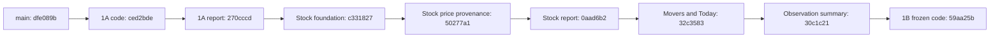

# RH-PIPELINE-1B — integration and dynamic Signal Desk

This candidate integrates RH-PIPELINE-1A and the Stock Token evidence foundation, then makes Movers and Today read durable observations. Current facts carry exact token/pair identities, source timestamps, coverage and investigation routes. Reviewed campaign material, classifications and Daily Receipts remain separate historical memory.

## Pinned ancestry and preserved work

| Reference | Exact full SHA |
| --- | --- |
| Fetched `origin/main`, selected merged integration base | `dfe089bb71c6b4c52acdfb0e8e5b8cc331a13a2f` |
| 1A qualified implementation | `ced2bdeb5ddf4a8bb0514c3ae9962f52cbd42977` |
| `codex/rh-pipeline-1a` tip | `270cccdb439ee6929d5dab4c778061c1e1b8581f` |
| Stock Token qualified implementation | `50277a1a879270f95f86b8b60b81cc26288c8260` |
| `codex/rh-pipeline-1b-stock-rwa` tip / stacked input | `0aad6b22b1d3514cf57225501cb8dbed02622237` |
| 1B frozen implementation | `59aa25bd28a6e001fa52fbfa8f13eea2e3d04eac` |

The Stock branch already contains 1A. The fetched main tip is unchanged and is an ancestor of both. A new managed worktree and `codex/rh-pipeline-1b-integration` were created from the stacked input. No merge, duplicate cherry-pick or conflict resolution was needed. The two original successful runs were treated as prior evidence, not combined qualification.

The original main checkout and original candidate checkout remain intact. There were two candidate branches on one original candidate worktree, rather than two separate candidate checkouts: the checkout contains Stock/RWA; the 1A ref remains pinned at `270cccd`. Both refs, the original source/report contents, and the original local-only inventory were preserved. No existing worktree was archived or switched.

The implementation reports were read and hashed. The only file overlap between the 1A increment and the subsequent Stock increment is `src/api/app.ts`; it was already reconciled in the descendant Stock branch. Other local release candidates were not assumed approved or incorporated. [Reconciliation evidence](evidence/rh-pipeline-1b/reconciliation.json) contains full ancestry, report commitments, preservation checks, branch migration hashes and exact inventories.

## Dynamic Movers

`GET /v1/rh-chain/market/movers` is the canonical read projection. `/v1/4663/market/movers` uses the same reader, schema, source identities and calculation. `/v1/4663` references the shared route and labels its pre-existing rotation snapshot as historical. No second collector, market database or authority path was introduced.

The projection enumerates contracts from retained raw observations, then reads a bounded recent window plus the latest retained record. Public reads never call market providers, collect data, read private wallets or publish candidates. Production requires a durable store. Store capability/failure and registry availability are explicit; a failed stock-registry read cannot invent stock identity.

Eligibility requires the mainnet DEX identity `robinhood` mapped to 4663, exact EVM base token/quote identities, a valid exact pair id, source reference, finite required metrics and actual source/fetch age. Duplicate tickers retain separate contract identities. Duplicate pair/time measurements collapse only when consistent; disagreement and cross-contract pair collisions are excluded. A token contributes one eligible pool, selected by liquidity, rolling 24h volume and exact pair id. Pools are neither summed nor given each other's baselines.

| Rule | Versioned v1 value |
| --- | --- |
| Freshness / tolerated clock skew | 15 minutes / at most 60 seconds |
| Baseline | Approximately 1 hour before the latest source observation, within 10 minutes |
| Required samples / largest gap | At least 6 / at most 20 minutes |
| Minimum current liquidity / rolling 24h volume / transactions | $10,000 / $1,000 / 10 |
| Universe bound | 300 inspected contracts; an exceeded bound withholds ranking because collision coverage is incomplete |
| History claimed by the score | The actual covered baseline window, not a seven-day persistence claim |

Missing price, liquidity, rolling 1h/24h volume, or buy/sell transaction counts prevent ranking. Zero baselines, sparse history, stale values, malformed attribution and nonfinite deltas have explicit research reasons. Unavailable inputs are not silently scored as zero. Observed zero current volume is preserved. Unknown provider observation times use explicitly labeled provider-fetch time.

The deterministic method is `rh-market-significance-v1`:

| Component | Maximum points | Calculation |
| --- | --- | --- |
| Rolling 1h volume change | 25 | Absolute relative change saturates at 200% |
| Liquidity change | 20 | Absolute relative change saturates at 30% |
| Rolling 24h transaction change | 20 | Absolute relative change saturates at 100% |
| Price change | 15 | Absolute relative change saturates at 20% |
| Persistence | 10 | Fraction of subsequent samples retaining the dominant component's direction and at least half its final relative change; flat changes score zero |
| Evidence | 10 | Five points for required qualified coverage, plus five times the fraction of samples with provider observation timestamps |

Each component is rounded to two decimals before summing. Calculations use unrounded source ratios; displayed deltas and persistence ratios are rounded. Referenced samples support exact replay. Dominant-component ties use the declared volume/liquidity/transaction/price order. Final ranking ties use score, absolute volume change, liquidity, exact contract and pair. Projection identity remains stable while age advances within eligibility and changes when evidence or eligibility changes.

This score measures observed significance. Declines may be significant; rolling DEX volume is not capital flow. Raw Stock Token USD price changes are not corporate-action-adjusted underlying-equity returns. Holder, deployer trust, safety and reviewed classifications are not inferred from these metrics. Stock lane labels reuse the persisted official registry; its detailed provenance/freshness remains available through the existing exact-contract Stock evidence API. Broader issuer/corporate-action collection remains outside this stage.

## Today, API compatibility and the public interface

Today selects a qualified Stock Token observation first when one exists, then exposes measured volume and liquidity changes. Every active card supplies observation and evidence ids, source reference, observed timestamp, time basis, freshness, coverage and an exact-contract investigation link. Empty/stale/failed market reads produce availability notices with no invented market timestamps or numbers. Receipt storage failure does not erase healthy market observations.

Reviewed Receipt #006 and other published Daily Receipts retain their identifiers and publication controls. Campaign and editorial risk material remains under labeled historical memory, with original timestamps. Liquidity change is presented as a measured fact, not a reviewed risk finding.

For existing index clients, legacy `assets`, `overview`, `scoring_model`, thresholds and campaign fields remain available, explicitly scoped by `legacy_fields_scope=HISTORICAL_EDITORIAL_MEMORY`. The active ranking is **`market_movers.assets`**, declared by `active_ranking`. `/v1/rh-chain/4663-index/memory` exposes the original reviewed index separately. Updated Signal Desk pages use the active projection even when empty; they never substitute a manual asset into current Movers.

The summary rail and provenance component use observation freshness for current market context. Persistence is labeled as storage, without implying human review. The index anchor points to the observed ranking; historical classifications stay behind a separate disclosure.

Browser revalidation runs once per minute on visible tabs, coalesces in-flight work, resumes on visibility return and cleans up on unmount. It reads API projections only. Last-known evidence retains its source age after a failed request, and expired rows are removed from the current ranking. Shared public responses are `no-store`, insensitive to wallet/authentication headers, and contain no private overlays. `/4663/me` and canonical CALL/proof boundaries are unchanged.

This stage does not replace the canonical `/v1/4663/today` edition lifecycle or complete `/4663` NOW/WATCH/OPEN LOOPS composition. Those surfaces keep their existing reviewed/publication semantics. Automatic daily factual editions remain 1C; the broader frontdoor integration and deployment qualification remain 1D.

## Storage, migration and flags

The combined candidate contains 18 inherited up migrations: main's 17 plus `20261012_024_rh_market_observation_history`. 1B adds none and does not renumber migrations. Reserved 018–023 belong to other unmerged candidates and remain outside this base.

The Stock foundation's optional multiplier-source metadata remains compatible with persisted Reflexive JSON. Snapshot enumeration and the optional recent-window argument extend the existing store interface without changing write identity or aggregates. Adapters without universe enumeration return an explicit unavailable projection; existing snapshot/history methods retain their contracts.

All inherited migrations were rehearsed in isolated disposable PostgreSQL schemas. Schema/index/trigger inspection has no pending required migrations. Tests cover concurrent raw insertion, duplicate replay, independent pool restart, memory/PostgreSQL ranking parity, UTC offsets, raw expiration and preservation of daily evidence, plus the original 1A migration backfill/rollback/trigger/locking matrix. Raw retention remains 48 hours, hourly retention 90 days and daily aggregates durable. Pruned raw history is not reconstructed into a current baseline.

The original flag interactions are preserved: capture/history may be enabled through their individual flags or the existing automation equivalent, but the dedicated market schedule additionally requires `RH_CHAIN_MARKET_SCHEDULER_ENABLED`. All three individual switches default false. The default interval remains `RH_CHAIN_MARKET_SNAPSHOT_INTERVAL_MS=300000`; the collector requires PostgreSQL pool capacity of at least two. No Phase 2/3 publication, external distribution, paid service or trade setting was enabled.

These are deployment prerequisites, not authorization to change an environment. Roll back only this read-model increment to stacked input `0aad6b22b1d3514cf57225501cb8dbed02622237`; no 1B down migration is needed. Preserve populated 024 history. Disabling a separately authorized collector does not remove records; freshness continues to age and ranking excludes expired observations.

## Evidence and release gates

- [Qualification and log commitments](evidence/rh-pipeline-1b/qualification.json)
- [Branch reconciliation and exact changed files](evidence/rh-pipeline-1b/reconciliation.json)
- [Migration ledger and schema inspection](evidence/rh-pipeline-1b/migration-ledger.json)
- [Observations read back from PostgreSQL](evidence/rh-pipeline-1b/persisted-observations.json)
- [Actual Movers/Today API fixture responses](evidence/rh-pipeline-1b/api-examples.json)
- [Per-test assertions](evidence/rh-pipeline-1b/test-assertions.json)
- [Local browser smoke evidence](evidence/rh-pipeline-1b/browser-checks.json)

API examples are synthetic, explicitly clocked fixtures queried from PostgreSQL, not live prices or measured production coverage. Thirteen stored samples produce one mover and three active Today cards; duplicate replay adds zero rows. Both API routes return the same canonical projection and the fixture makes zero upstream requests. Source provenance and exact contracts/pairs are included in the artifacts.

The validation host is local macOS/Node 25.6.1 with disposable PostgreSQL 14.20. Browser checks use a loopback-only fixture with ingestion, automation, publication and network providers disabled. They are a smoke check of rendered data, links, semantic controls and mobile overflow, not full accessibility certification or deployment/performance proof.

No CALL, RESOLUTION, Genesis, cryptographic receipt proof, IPX economics or Radar judgment authority implementation was changed. Protected implementation hashes are checked against the selected main ancestor. No push, merge, staging/production deployment, production setting change, publisher activation or public automation was performed. Final counts and separate PASS/HOLD verdicts are recorded below after frozen-code qualification.

## Final frozen-code result

**1,978 tests passed across 268 files, with zero failures or skips.** All 46 new 1B tests passed, alongside the original 1A, Stock/RWA, PostgreSQL, RH Pulse, Reflexive Radar and Radar judgment regressions. Typecheck, lint, server/client build, diff checks and local browser smoke checks passed. The build retains the existing large-chunk warning.

| Gate | Verdict | Evidence / boundary |
| --- | --- | --- |
| Code qualification | **PASS** | Frozen code `59aa25bd28a6e001fa52fbfa8f13eea2e3d04eac`; complete test/check results committed. |
| Integration | **PASS — local candidate** | Both input branches are present by ancestry; fresh combined qualification, migration/store compatibility, protected hashes and preserved originals. |
| Staging authorization | **HOLD** | No staging deployment authorized or performed; environment-specific readiness remains separate. |
| Production activation | **HOLD** | Explicitly prohibited by this directive; no publication, settings or public automation activation. |

## Exact 1B changed-file inventory

- `src/api/app.ts`
- `src/api/openapi.ts`
- `src/data/rhChain.ts`
- `src/services/rhChainIntelligenceService.ts`
- `src/services/rhChainMarketMoversService.ts`
- `src/services/rhChainMarketSnapshotService.ts`
- `src/services/rhChainTodayOn4663Service.ts`
- `src/web/rhChainMarketMovers.tsx`
- `src/web/rhChainMarketRevalidation.ts`
- `src/web/rhChainSignalDeskPages.tsx`
- `src/web/rhChainSignalDeskSelectors.ts`
- `src/web/rhChainSignalDeskV2.tsx`
- `src/web/rhChainUi.tsx`
- `tests/helpers/rhMoverObservations.ts`
- `tests/rh-chain-api.test.ts`
- `tests/rh-dynamic-market-postgres.test.ts`
- `tests/rh-dynamic-today.test.ts`
- `tests/rh-market-movers.test.ts`
- `tests/rh-market-revalidation.test.ts`
- `tests/rh-observed-market-ui.test.tsx`

The complete combined inventory relative to main, including inherited 1A/Stock changes and reports, is in the reconciliation artifact. This delivery report and evidence files are committed separately from the qualified implementation.
