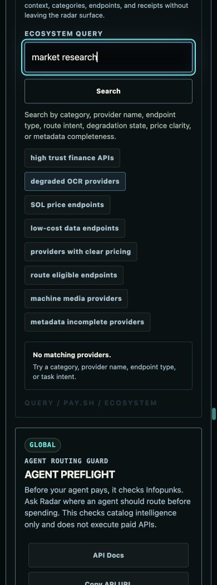
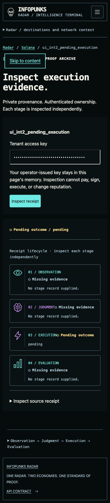

# Infopunks Radar UX hardening — HOLD

**Implementation update:** UX-01 through UX-13 received explicit authorization for isolated implementation. The completed [implementation report](implementation-report.md), [issue ledger](issue-ledger.md), and [before/after evidence index](evidence/implementation/review-index.md) record the resulting branch and fresh qualification. G1 stays PASS; G2 and release stay HOLD. The audit text below is retained as the original pre-implementation decision record.

Independent audit, 2026-10-13, Asia/Colombo. **Approval is required before implementation**, as requested in Step 4. No application code, contracts, frozen baselines, branch history, deployment or production data was changed.

Audited candidate: `codex/radar-terminal-secure-integration`, `d3d0a445ec20e8c55170c2fc1f52aff220b2a851`. Local compiled preview: port 5183; explicit synthetic tenant API: port 8812. Application, test, migration and dependency sources have no differences from qualified application commit `35f2e54a288311d1df0f8820dacb216c27175791`. The candidate checkout was left clean.

## Review packet

1. [Independent audit and limitations](independent-audit.md)
2. [P0–P3 defect register](defect-register.md) — 13 issues: **0 P0, 4 P1, 7 P2, 2 P3**
3. [Nine journeys and edge cases](journeys.md)
4. [Component-level correction plan](remediation-plan.md)
5. [Visual comparison and Design QA](design-qa.md)
6. [Accessibility, browser and performance qualification](qualification.md)
7. [Every captured route](route-evidence.md)
8. [Machine-readable register](defect-register.csv) and [evidence manifest](evidence/manifest.json)

The current run captured 138 customer-facing route samples covering 129 customer router patterns. The internal review console is excluded. Twelve representative surfaces passed 84 width checks at 320/375/390/430/768/1024/1440; the 138-route initial sweep also had no document overflow at 390px. These checks cover rendered states, not every record, permission, backend condition or device.

`check:design` passes. Five focused test files pass **19/19 tests**. The Premium static audit reports 57 findings; these are contract/static findings, not 57 demonstrated WCAG failures. Full qualification and before/after implementation evidence remain pending authorization.

Product Design Audit and its Design QA comparison method were used with Frontend Design Premium. Figr connectivity returned `USER_NOT_LOGGED_IN`; Figr analysis is unavailable, and the journey review below is independently derived from the browser and repository. No result is attributed to Figr.

## Proposed approval scope

Approve corrections **UX-01 through UX-13**, implemented in stages on a new isolated branch from the integration candidate. All corrections use the existing constitution, tokens and shared owners. No alternate theme, rebrand, new product layout, Judgment decision mapping, receipt authority, payment action or security behavior is proposed. Performance work begins with measurements; route extraction proceeds only when the measured cost and regression evidence justify it.

Current assessment: **HOLD**. Test-spend and deterministic-denial browser states, full outage/retry, new axe automation, assistive technology, real devices, stable full-page comparisons and field performance are not qualified by this run. Approval permits implementation and qualification only; it does not permit merge, deployment or a release-readiness claim.

## Two demonstrated deficiencies

Typing a query before submitting it already displays “No matching providers.”

Pending execution remains pending, but stage names and status text run together and ancestor inspection requires opening JSON.

