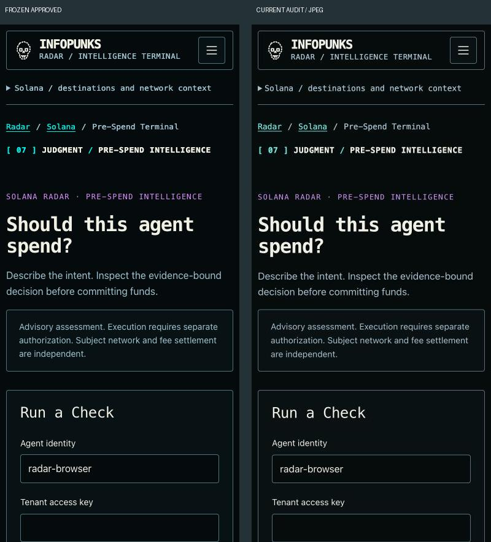

# Design QA comparison

**final result: blocked**

This is a read-only application audit with a requested comparison to frozen approval, using Product Design's comparison method. It is not a new prototype build. No fix/capture iteration has been performed because the user requires correction approval first.

## Source visual truth

Integration checkout: `/Users/ahdilm/.codex/worktrees/radar-terminal-secure-integration/Infopunks Pay.sh Intelligence Terminal`.

Canonical identity image: `docs/design-system/references/infopunks-radar-canonical-cyan-terminal.png`, **1086 × 1032**. It was opened and inspected; its own layout size is not treated as the 1440px acceptance baseline.

Matching-view references: `docs/design-system/references/ui-int2-approved-completed/loaded-{desktop|mobile}-{home|spend-terminal|receipts|rh-chain-signal-desk|solana}.png`. Approval and SHA-256 evidence: `docs/design-system/ui-int2/visual-approval-completed.json`. Frozen references were not edited.

Current screenshot paths: `evidence/qa-{desktop|mobile}-{surface}.jpg`, captured from port 5183 in this run. Source and candidate use the same anonymous route, initial form/brief mode and viewport. No local credential is used in these comparisons.

## Normalization and comparison evidence

Desktop CSS viewport/current image: **1440 × 1000**; mobile: **390 × 844**. Frozen full-page screenshots are width 1440/390 respectively; the homepage full heights are 1628/3738. Each reference is cropped to the same first viewport without rescaling. Current image pixels equal the requested CSS dimensions (1 pixel per CSS pixel for these captures). No phone frame or browser chrome is included.

Ten full-view pairs: `evidence/pair-qa-{desktop|mobile}-{surface}.jpg`. Focused homepage typography/header/Signal Lens comparison: [focused pair](evidence/qa-focused-home.jpg), equal **800 × 500** source/current crops. Mobile pairs retain readable typography and exact grouping at 390px. Separate authenticated inspected-state captures establish the lifecycle finding, rather than pretending anonymous source references include those records.

| Surface | Typography / rhythm | Colors / assets / copy | Result and limits |
|---|---|---|---|
| Homepage desktop/mobile | Headline wrap, mono utility roles, panel alignment and Signal Lens placement visibly retain the approved composition. | Same Signal Lens subject/crop, icons and no-check vocabulary. Current screenshot cyan appears lighter than frozen PNG. Runtime action token still computes to `#00eee4`; exact pixel/color equality is not established across capture pipelines. | Composition retained in paired evidence; lossless visual gate remains HOLD. |
| Spend desktop/mobile | Initial form hierarchy, intro and split/stack layout retain the approved composition. | Field labels and default form state match; no new visual system. | Initial viewport retained; completed result/validation corrections still pending. |
| Receipts desktop/mobile | Heading, intro panel and metric grid retain composition. | One counter changes from 5 to 6 completed checks in this disposable runtime; this is data-state difference, not a layout fix. | Static composition comparable; dynamic count is not pixel identity. |
| RH desk desktop/mobile | Brief-mode headline and two-column/stacked layout retain composition. | Existing contract form and source disclaimer retain identity. | An early desktop capture showed loading; rejected and replaced by a loaded contract-form capture. Current data/runtime equivalence still needs deterministic fixtures. |
| Solana desktop/mobile | First-viewport hierarchy, display/body/mono roles and restrained panels retain composition. | Existing CTA/content and advisory copy retain identity. | First-viewport review only. Stable full-page visual qualification remains open; the inherited baseline already records asynchronous-height drift. |

All five fidelity surfaces were explicitly reviewed: typography, spacing/layout, color tokens, image/asset fidelity, and application copy. No replacement assets, fabricated visual evidence or alternate palette are proposed. The lighter cyan rendition is a comparison limitation to resolve with the existing lossless pipeline, not proof that source tokens changed or an instruction to retune the palette.

## Findings / history

Iteration 0: ten initial-view comparisons, focused homepage comparison and independent completed proof captures inspected. UX-06 lifecycle label/status grouping is actionable P2; broader P1/P2 usability findings are in the defect register. Early loading/wrong-section captures were rejected. No application or reference fixes were made.

Iteration 1 and later: pending approval. Each approved correction must have a new matched-state capture, an itemized intended diff and unchanged sibling-screen evidence. The result stays blocked while P1/P2 corrections or lossless/current-state qualification are unresolved.

